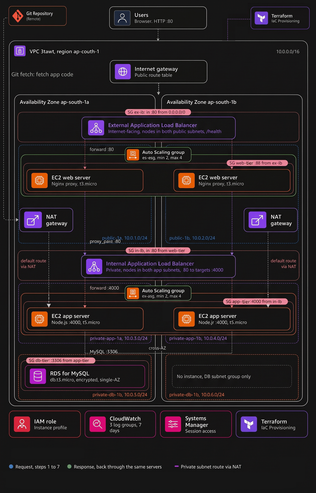

# AWS Three-Tier Application Deployment with Terraform

A three-tier Node.js application deployed on AWS using Terraform, EC2
Auto Scaling, Application Load Balancers, Amazon RDS for MySQL, and
CloudWatch Logs.

## Architecture

### Request flow :
``` text
                         Users / Internet
                                |
                                v
                 External Application Load Balancer
                              HTTP :80
                                |
                                v
                   Web EC2 Auto Scaling Group
                           Nginx :80
                                |
                                v
                 Internal Application Load Balancer
                              HTTP :80
                                |
                                v
                    App EC2 Auto Scaling Group
                       Node.js / Express :4000
                                |
                                v
                         Amazon RDS MySQL
                              TCP :3306
```
###  :




## AWS Services & Tools

-   **Terraform** --- Infrastructure as Code
-   **VPC, Subnets, Route Tables, Security Groups** --- Networking and
    security
-   **Application Load Balancers** --- Route traffic between tiers
-   **EC2 Auto Scaling Groups** --- Run and scale web/app instances
-   **Nginx** --- Web server and reverse proxy
-   **Node.js / Express** --- Application backend
-   **Amazon RDS MySQL** --- Database
-   **CloudWatch Logs / Agent** --- Centralized log collection
-   **IAM** --- Permissions for AWS resources

## Repositories

-   **Terraform:**
    https://github.com/rizwancloud/terraform_code_3tier_deployment
-   **Application:** https://github.com/rizwancloud/application_nodejs

## Deployment

Prerequisites: AWS CLI, Terraform, Git, and AWS credentials configured
securely.

``` bash
git clone https://github.com/rizwancloud/terraform_code_3tier_deployment.git
cd terraform_code_3tier_deployment

terraform init
terraform validate
terraform plan
terraform apply

```

Review the Terraform variables and configuration first. Inspect the plan
before applying changes.

## Request Flow

1.  The external ALB receives HTTP traffic.
2.  Nginx receives requests on the web tier and forwards them to the
    internal ALB.
3.  The internal ALB routes requests to healthy Node.js instances.
4.  The application connects to RDS MySQL when database access is
    required.
5.  Responses return through the same path.

## Logging

The project has been configured to collect Nginx access/error logs and
Node.js application logs in CloudWatch Logs. Separate systemd journal
collection remains a follow-up task.

Useful commands:

``` bash
sudo systemctl status nginx --no-pager -l
sudo systemctl status app --no-pager -l
sudo journalctl -u app -n 100 --no-pager
curl -i http://127.0.0.1:4000/health
```

## Troubleshooting

-   **502 Bad Gateway:** Check ALB target health, listener/target ports,
    security groups, Nginx upstream settings, and app service status.
-   **Unhealthy targets:** Verify health-check path, port, service
    status, and network access.
-   **App not responding:** Check `systemctl status app`,
    `journalctl -u app`, and whether Node.js listens on port `4000`.
-   **Database connection error:** Verify RDS endpoint, database name,
    credentials, and app-to-RDS security-group rules.
-   **CloudWatch logs missing:** Check agent status/configuration, IAM
    permissions, file paths, and network connectivity.

## Security

-   Keep RDS private and allow MySQL traffic only from the app tier.
-   Allow app traffic only from the internal ALB.
-   Do not commit credentials, `.env` files, private keys, or Terraform
    state.
-   Use IAM roles instead of long-lived AWS access keys on EC2.
-   Review Terraform plans before applying or destroying resources.

## Cleanup

For a disposable environment, review the destroy plan before deleting
resources:

``` bash
terraform plan -destroy
terraform destroy
```

**Warning:** Destroying resources can delete infrastructure and data.
Verify the workspace and plan before confirming.

## Interview Summary

I deployed a three-tier Node.js application on AWS using Terraform. The
external ALB routes traffic to Nginx web instances, which forward
requests to an internal ALB. The internal ALB distributes traffic to
Node.js application instances, which connect to Amazon RDS MySQL. I also
configured CloudWatch logging and troubleshot load-balancer health
checks, application services, and connectivity.

------------------------------------------------------------------------

**Note:** Confirm exact resource settings and log group names in the
current Terraform configuration before publishing. Only claim features
that you implemented and verified.
